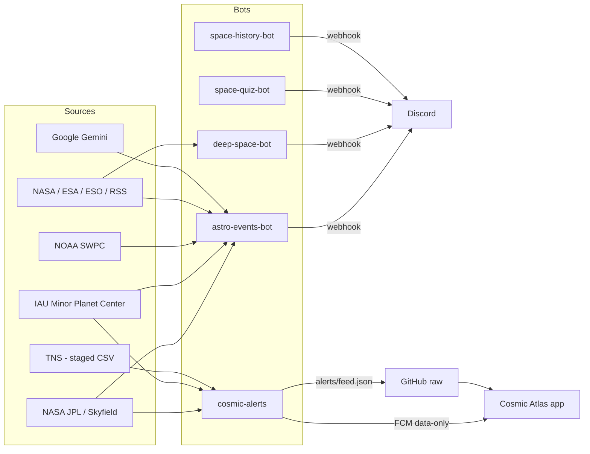

<div align="center">
  
</div>

<p align="center">
  <a href="https://cosmic-atlas.app/"></a>
  <a href="https://play.google.com/store/apps/details?id=com.cosmic.atlas"></a>
  <a href="https://discord.com/invite/JvPSgHA2jB"></a>
</p>

# Cosmic Nexus — Bots

**The automation layer behind [Cosmic Atlas](https://cosmic-atlas.app/)** — an astrophotography planner for Android.

This repository runs a small fleet of bots that watch the sky, the news and the newest discoveries,
then turn them into two things people actually use:

- **Daily Discord content** — conjunctions, meteor showers, aurora alerts, NASA APOD, telescope imagery, quizzes and space history.
- **Live data for the Cosmic Atlas app** — comets, interstellar visitors and **TNS supernovae**, delivered as a public feed and as push notifications.

Everything runs on **GitHub Actions**. There is no server to maintain: state lives in the repo as SQLite caches and JSON snapshots.

---

## What is Cosmic Atlas?

[Cosmic Atlas](https://cosmic-atlas.app/) is a mobile planner for astrophotography. It combines weather, Moon phase,
catalog visibility and equipment profiles to answer one question: *what can I photograph tonight, and when?*

The app is available on **[Google Play](https://play.google.com/store/apps/details?id=com.cosmic.atlas)**, and the community
lives on **[Discord](https://discord.com/invite/JvPSgHA2jB)**.

This repo provides the *live discovery* half of that experience: comets from the Minor Planet Center and
transients from the Transient Name Server (TNS), plus the content engine for the Discord community.

---

## The bots

| Module | Runtime | What it publishes | Schedule |
| :--- | :---: | :--- | :--- |
| **`astro-events-bot`** | Python | Conjunctions ≤ 1°, planetary alignments (≥ 4 planets), oppositions, lunar occultations, meteor showers (7-day and 24-hour notice), deep-sky seasons, NOAA geomagnetic storms (Kp ≥ 5 with the aurora oval map), comets from COBS/MPC | daily, 07:00 & 09:00 UTC |
| **`deep-space-bot`** | Python | NASA APOD, JWST / Hubble / Euclid / Chandra / Rubin imagery, ISS & Tiangong crew, new exoplanets, rocket launches (T-60 / T-15 / T-0) | daily, 14:00 & 18:00 UTC |
| **`space-quiz-bot`** | Python | A daily astronomy quiz generated with Gemini AI — 6 categories, no repeats (SQLite) | daily, 12:00 UTC |
| **`space-history-bot`** | Python | “Today in space history” — Apollo, Voyager, Shuttle, Artemis, with verified imagery | daily, 16:00 UTC |
| **`cosmic-alerts`** | Node.js | MPC comets + **TNS discoveries** (supernovae, novae, transients) → FCM push for Cosmic Atlas + the public JSON feed | every 10 minutes |

The Python bots are coordinated by `main_orchestrator.py`, which runs each module in isolation (`run_safe`) and
uses `scheduler.db` to avoid premature runs.

---

## How the data flows



The app **never** talks to TNS, NASA or the MPC directly. It downloads a single public JSON feed (~60 KB), so it
needs no API keys, no accounts and no external authentication.

### Inside `cosmic-alerts`

- **Comets** come from the MPC `CometEls.txt` list, filtered by absolute magnitude and perihelion window.
- **Transients** come from the public **TNS staged CSVs** (the officially recommended method), never from the
  per-object search API. On the first run the full catalogue is imported once; afterwards only yesterday’s delta
  plus the last few hourly deltas are fetched.
- Records are filtered locally: optical transients only, valid coordinates, magnitude ≤ 20, discovery within
  30 days. Supernovae are prioritised over faint unclassified transients.
- The feed keeps at most 300 objects. The app filters it down to what is visible tonight and shows the best 15.

---

## Repository layout

```text
Cosmic_Bots/
├── main_orchestrator.py          # schedules and runs the Python modules safely
├── google_ai_helper.py           # Gemini wrapper (news, quiz, urgency classification)
├── persistent_history.py         # global persistence, prevents duplicate posts
├── published_history.json        # committed state: what has already been published
├── assets/banner.svg             # repository banner (README header)
│
├── astro-events-bot/             # astronomical events + space weather
├── deep-space-bot/               # APOD, telescopes, ISS, launches, exoplanets
├── space-quiz-bot/               # daily quiz
├── space-history-bot/            # today in space history
│
├── cosmic-alerts/                # Node.js: MPC + TNS -> FCM + public feed
│   ├── src/index.mjs             # orchestration, feed writing, notifications
│   ├── src/mpc.mjs               # MPC comet list
│   ├── src/tnsCsv.mjs            # TNS staged CSV download (ZIP, zero dependencies)
│   ├── src/tns.mjs               # filtering, prioritisation, feed building
│   ├── src/verify-tns.mjs        # local TNS access check
│   ├── alerts/feed.json          # public feed consumed by the app
│   └── .state/seen.json          # comets and discoveries already published
│
└── .github/workflows/
    ├── astronomy_cron.yml        # six runs per day for the Python bots
    └── cosmic-alerts.yml         # every 10 minutes: comets + TNS + feed
```

---

## Security model

This repository is public on purpose, and it is designed to stay safe that way:

- **No credentials in code.** Discord webhooks, `GEMINI_API_KEY`, `NASA_API_KEY`,
  `FIREBASE_SERVICE_ACCOUNT` and the TNS credentials live exclusively in **GitHub Actions Secrets**.
  Only the secret *names* appear in the workflow files.
- **No secrets in history.** The repository has been audited: no keys, tokens, webhooks or private keys
  in any commit.
- **`.env`, SQLite databases and JPL `.bsp` ephemerides are git-ignored.**
- **TNS access without the API.** Only the public staged CSVs, with an access marker; no per-object queries.
- **Push retries.** Workflows rebase before pushing, so they never collide with the other bots that commit state.

Recommended after publication: **Settings → Code security → Secret scanning + Push protection**.

---

## Local development

### Python bots

```bash
pip install -r astro-events-bot/requirements.txt
cp .env.example .env     # fill in the webhooks and API keys
python main_orchestrator.py
```

Environment variables: `EVENTS_BOT_DISCORD_WEBHOOK_URL`, `DEEP_SPACE_BOT_DISCORD_WEBHOOK_URL`,
`SPACE_QUIZ_BOT_DISCORD_WEBHOOK_URL`, `SPACE_HISTORY_BOT_DISCORD_WEBHOOK_URL` (plus the matching role IDs),
`GEMINI_API_KEY`, `NASA_API_KEY`, `TEST_MODE`.

### `cosmic-alerts` (Node.js)

```bash
cd cosmic-alerts
npm ci

# TNS access: user marker (no API key) or bot marker
export TNS_USER_ID=...
export TNS_USER_NAME=...

node src/verify-tns.mjs   # checks CSV access only
node src/index.mjs        # bootstrap, feed, optional push notifications
```

`FIREBASE_SERVICE_ACCOUNT` is **optional**: without it the public feed is still updated and only push
notifications are skipped.

---

## Documentation

| Document | Contents |
| :--- | :--- |
| [`DOCUMENTATIE_ECOSISTEM.md`](DOCUMENTATIE_ECOSISTEM.md) | full ecosystem architecture, broadcast schedule, Discord channels and roles |
| [`astro-events-bot/DOCUMENTATIE_BOT.md`](astro-events-bot/DOCUMENTATIE_BOT.md) | the eight astronomy modules, thresholds and ephemerides |
| [`deep-space-bot/DOCUMENTATIE_DEEP_SPACE.md`](deep-space-bot/DOCUMENTATIE_DEEP_SPACE.md) | launches, telescopes, APOD, ISS |
| [`space-quiz-bot/DOCUMENTATIE_QUIZ.md`](space-quiz-bot/DOCUMENTATIE_QUIZ.md) | quiz generation and anti-repetition |
| [`space-history-bot/DOCUMENTATIE_HISTORY.md`](space-history-bot/DOCUMENTATIE_HISTORY.md) | historical event selection |
| [`cosmic-alerts/README.md`](cosmic-alerts/README.md) | TNS/MPC pipeline, public feed, notifications |

---

<div align="center">

**Cosmic Nexus** powers the live layer of **Cosmic Atlas** — the astrophotography planner for tomorrow’s sky.

[Website](https://cosmic-atlas.app/) · [Google Play](https://play.google.com/store/apps/details?id=com.cosmic.atlas) · [Discord](https://discord.com/invite/JvPSgHA2jB)

<sub>Data: NASA/JPL · IAU MPC · TNS · NOAA SWPC · ESA · Google Gemini</sub>

</div>
