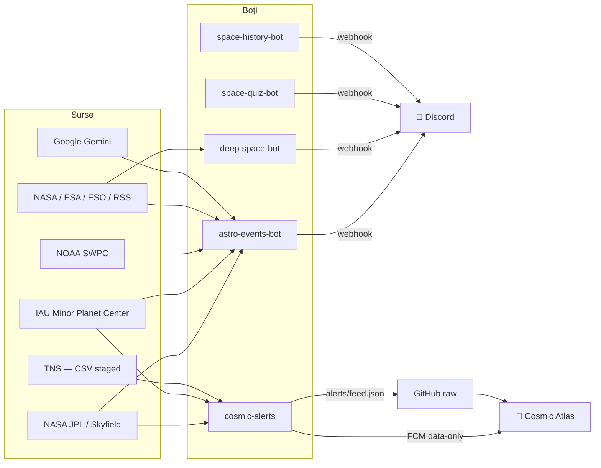

<div align="center">

# 🌌 Cosmic Nexus — Bots

**Ecosistemul automatizat de boți astronomici din spatele Cosmic Atlas.**
Python · Node.js · SQLite · GitHub Actions — fără server propriu, fără intervenție manuală.

[](https://cosmic-atlas.app/)
[](https://play.google.com/store/apps/details?id=com.cosmic.atlas)
[](https://discord.com/invite/JvPSgHA2jB)


</div>

---

## Ce face acest repo

Un singur repo care ține în viață două lucruri:

1. **Conținutul zilnic de pe serverul de Discord** — evenimente astronomice calculate cu efemeride NASA JPL, știri spațiale, poza zilei, quiz și istorie.
2. **Datele live din aplicația Cosmic Atlas** — comete, obiecte interstelare și **supernove TNS**, livrate ca feed public și ca notificări push.

Totul rulează pe **GitHub Actions**, cu starea persistată în repo (SQLite cache + JSON), fără un server care trebuie întreținut.

> 🔭 Site: **[cosmic-atlas.app](https://cosmic-atlas.app/)** · 📱 App: **[Google Play](https://play.google.com/store/apps/details?id=com.cosmic.atlas)** · 💬 Community: **[Discord](https://discord.com/invite/JvPSgHA2jB)**

---

## Boții

| Modul | Limbaj | Ce publică | Program |
| :--- | :---: | :--- | :--- |
| **`astro-events-bot`** | Python | Conjuncții ≤1°, alinieri planetare (≥4 planete), opoziții, ocultații lunare, ploi de meteoriți (preaviz 7 zile + 24 h), sezoane Deep-Sky, furtuni geomagnetice NOAA (Kp ≥ 5, cu harta ovalului auroral), comete din COBS/MPC | zilnic, 07:00 & 09:00 UTC |
| **`deep-space-bot`** | Python | NASA APOD, imagini JWST / Hubble / Euclid / Chandra / Rubin, echipajul ISS & Tiangong, exoplanete noi, lansări de rachete (T-60 / T-15 / T-0) | zilnic, 14:00 & 18:00 UTC |
| **`space-quiz-bot`** | Python | Quiz spațial zilnic generat cu Gemini AI, 6 categorii, fără repetiții (SQLite) | zilnic, 12:00 UTC |
| **`space-history-bot`** | Python | „Azi în istoria spațiului” — Apollo, Voyager, Shuttle, Artemis, cu imagini verificate | zilnic, 16:00 UTC |
| **`cosmic-alerts`** | Node.js | Comete MPC + **descoperiri TNS** (supernove, nove, AT-uri) → notificări push FCM pentru Cosmic Atlas + feed public JSON | la fiecare 10 minute |

**Orchestratorul** (`main_orchestrator.py`) rulează cele patru boți Python în sloturile de mai sus, izolat (`run_safe`), cu `scheduler.db` pentru a preveni rulările premature.

---

## Cum circulă informația



Aplicația **nu** vorbește niciodată cu TNS, NASA sau MPC. Cere doar feed-ul public (~60 KB), deci nu are nevoie de chei și nu depinde de disponibilitatea serviciilor externe.

---

## Structura repo-ului

```text
Cosmic_Bots/
├── main_orchestrator.py          # rulează boții Python pe sloturi, izolat
├── google_ai_helper.py           # wrapper Gemini AI (știri, quiz, clasificare urgență)
├── persistent_history.py         # persistență globală (fără duplicate)
├── published_history.json        # stare versionată: ce s-a publicat deja
│
├── astro-events-bot/             # evenimente astronomice + vreme spațială
├── deep-space-bot/               # APOD, telescoape, ISS, lansări, exoplanete
├── space-quiz-bot/               # quiz zilnic
├── space-history-bot/            # azi în istoria spațiului
│
├── cosmic-alerts/                # Node.js: MPC + TNS → FCM + feed public
│   ├── src/index.mjs             # orchestrare + feed + notificări
│   ├── src/mpc.mjs               # comete MPC
│   ├── src/tnsCsv.mjs            # descărcare CSV staged TNS (ZIP, fără dependențe)
│   ├── src/tns.mjs               # filtrare, prioritizare, feed
│   ├── src/verify-tns.mjs        # test local al accesului TNS
│   ├── alerts/feed.json          # feed-ul public citit de aplicație
│   └── .state/seen.json          # stare: comete și descoperiri deja publicate
│
└── .github/workflows/
    ├── astronomy_cron.yml        # 6 rulări/zi pentru boții Python
    └── cosmic-alerts.yml         # la 10 minute: comete + TNS + feed
```

---

## Securitate

Repo-ul este proiectat să poată fi public fără să expună nimic sensibil:

- **Nicio cheie în cod.** Webhook-urile Discord, `GEMINI_API_KEY`, `NASA_API_KEY`, `FIREBASE_SERVICE_ACCOUNT` și credențialele TNS stau exclusiv în **GitHub Actions Secrets**.
- **`.env`, bazele SQLite și efemeridele `.bsp` sunt ignorate** (`.gitignore`) — nu ajung niciodată în git.
- **Niciun secret în istoric.** Auditul repo-ului nu găsește chei, token-uri, webhook-uri sau chei private în niciun commit.
- **Acces TNS fără API.** Doar CSV-urile staged publice, cu marker de acces; zero interogări per obiect.
- **Push cu reîncercare** — workflow-urile fac `pull --rebase` înainte de push, ca să nu se calce cu alți boți din repo.

Recomandat după publicare: **Settings → Code security → Secret scanning + Push protection**.

---

## Rulare locală

### Boții Python

```bash
pip install -r astro-events-bot/requirements.txt
cp .env.example .env            # sau exportă variabilele manual
python main_orchestrator.py
```

Variabile citite: `EVENTS_BOT_DISCORD_WEBHOOK_URL`, `DEEP_SPACE_BOT_DISCORD_WEBHOOK_URL`, `SPACE_QUIZ_BOT_DISCORD_WEBHOOK_URL`, `SPACE_HISTORY_BOT_DISCORD_WEBHOOK_URL` (+ rolurile aferente), `GEMINI_API_KEY`, `NASA_API_KEY`, `TEST_MODE`.

### `cosmic-alerts` (Node.js)

```bash
cd cosmic-alerts
npm ci
$env:TNS_USER_ID="..."; $env:TNS_USER_NAME="..."   # PowerShell
node src/verify-tns.mjs      # testează doar accesul la CSV-urile TNS
node src/index.mjs           # bootstrap + feed + (opțional) notificări
```

`FIREBASE_SERVICE_ACCOUNT` este **opțional**: fără el, feed-ul se actualizează normal, iar notificările push sunt omise.

---

## Documentație

| Document | Conținut |
| :--- | :--- |
| [`DOCUMENTATIE_ECOSISTEM.md`](DOCUMENTATIE_ECOSISTEM.md) | arhitectura completă, orarul de transmisie, canale & roluri Discord |
| [`astro-events-bot/DOCUMENTATIE_BOT.md`](astro-events-bot/DOCUMENTATIE_BOT.md) | cele 8 module astronomice, praguri, efemeride |
| [`deep-space-bot/DOCUMENTATIE_DEEP_SPACE.md`](deep-space-bot/DOCUMENTATIE_DEEP_SPACE.md) | lansări, telescoape, APOD, ISS |
| [`space-quiz-bot/DOCUMENTATIE_QUIZ.md`](space-quiz-bot/DOCUMENTATIE_QUIZ.md) | generarea quiz-ului și anti-repetiție |
| [`space-history-bot/DOCUMENTATIE_HISTORY.md`](space-history-bot/DOCUMENTATIE_HISTORY.md) | selecția evenimentelor istorice |
| [`cosmic-alerts/README.md`](cosmic-alerts/README.md) | TNS/MPC, feed-ul public, notificările |

---

<div align="center">

**Cosmic Atlas** — planificator de astrofotografie pentru cerul de mâine.

[🌐 cosmic-atlas.app](https://cosmic-atlas.app/) · [📱 Google Play](https://play.google.com/store/apps/details?id=com.cosmic.atlas) · [💬 Discord](https://discord.com/invite/JvPSgHA2jB)

<sub>Date: NASA/JPL · IAU MPC · TNS · NOAA SWPC · ESA · Google Gemini</sub>

</div>
